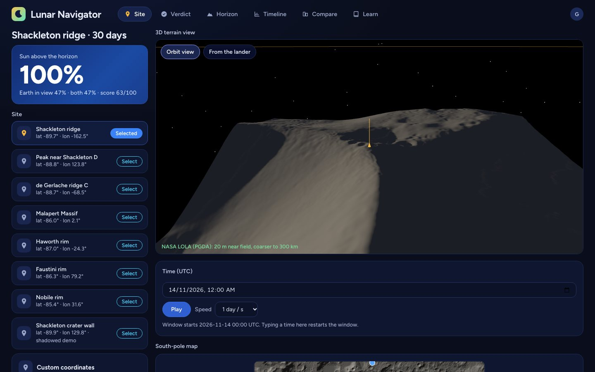
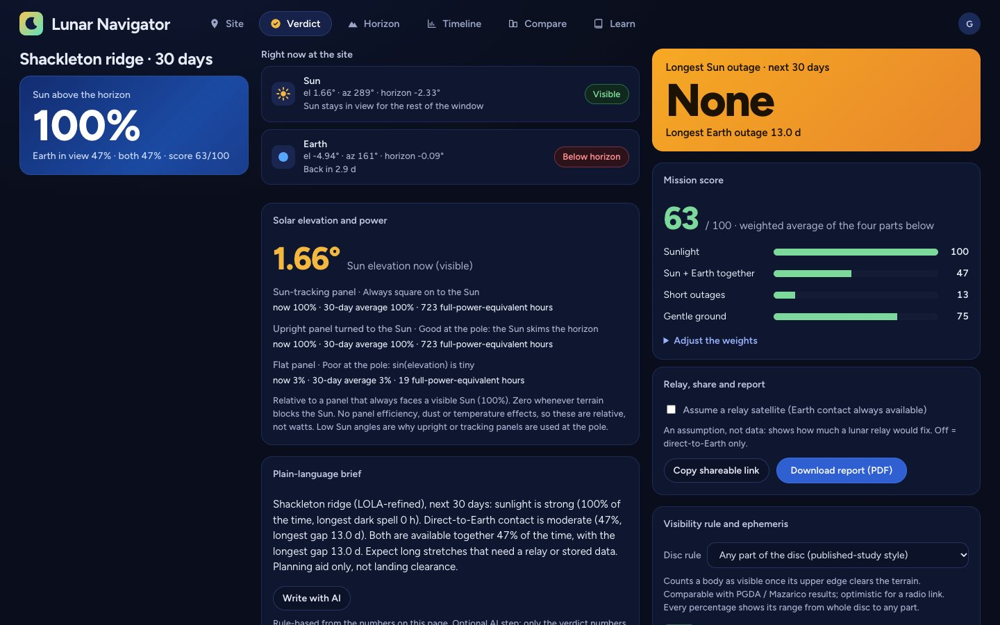
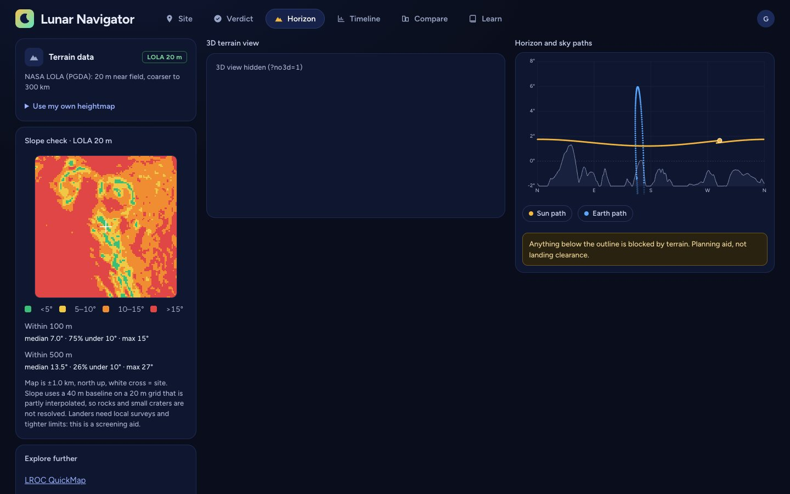
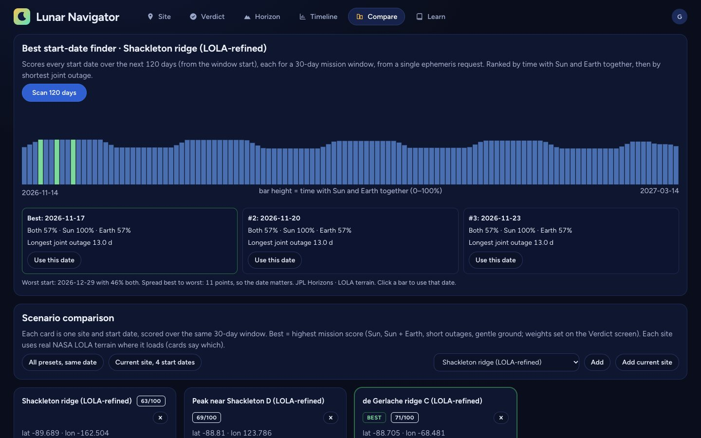
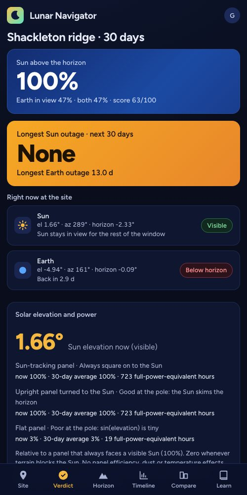

# Lunar Navigator

**Compare Moon landing sites and dates by the one thing that decides a south-pole mission: when the Sun and Earth are above the real local horizon.**

Built by team **GIT_HAPPENS** for the [NASA Space Apps Challenge 2026](https://www.spaceappschallenge.org/), challenge *Lunar Landing Site Navigator*.

**Live app: [lunar-landing-site-navigator-beige.vercel.app](https://lunar-landing-site-navigator-beige.vercel.app)**



---

## Why this exists

At the Moon's south pole the Sun never climbs more than about 1.5° above the horizon, so a single ridge can hide it for days. Earth can disappear behind terrain too, which decides whether a lander can talk to Earth directly. Missions slip, and planners then have to re-check other sites and other dates quickly.

NASA's tools hold the data (LROC QuickMap, Moon Trek, JPL Horizons) but each shows only part of the picture and is built for specialists. Lunar Navigator joins the two things that matter, **where the Sun and Earth are** (JPL Horizons) and **what the terrain hides** (NASA LOLA elevation), and turns them into one answer a planner, teacher or student can read in seconds.

> **Planning aid, not landing clearance.** It judges sunlight and Earth contact. It does not assess rocks, hazards or landing safety.

## What it does

The app is organised in tabs, one task per screen (desktop and phone):

| Tab | What you get |
|---|---|
| **Site** | 8 candidate south-pole sites, 11 Apollo / CLPS / Chang'e / Chandrayaan landing sites, custom latitude and longitude, antenna height, a 3D terrain view (orbit and "from the lander"), time controls with animation, and a south-pole map built from real LOLA data. |
| **Verdict** | Sun and Earth now (with a countdown to sunset and Earthset), longest outage, a solar elevation and power card for three panel types, an adjustable **mission score**, a relay-satellite switch, a plain-language brief (optional AI rewrite), **18.6-year long-term statistics** with NASA's own map shown beside them, a shareable link and a one-page PDF report. |
| **Horizon** | The terrain skyline in every direction with the Sun and Earth paths over it, the terrain data source, and a slope map from the LOLA grid. |
| **Timeline** | Hour-by-hour Sun and Earth visibility over 15, 30 or 60 days, with percentages and longest gaps. |
| **Compare** | A **best start-date finder** (scores every start date over 120 days from one Horizons request) and side-by-side scenarios for different sites or dates. |
| **Learn** | Why the pole is different (real Sun elevation next to an Earth day, axis tilt, no atmosphere), and a plain-English glossary. |

Every percentage is shown as a range because the Sun and Earth are discs, not dots (see [Visibility rules](#visibility-rules)).



## Screens

| Horizon | Compare | Phone |
|---|---|---|
|  |  |  |

## How it works

1. **Sun and Earth positions.** For the chosen site and window, the app asks **JPL Horizons** (DE441) for the Sun's and Earth's azimuth, elevation and apparent size every 3 hours, as seen from that point on the Moon. Libration is already inside those numbers. Horizons sends no CORS headers, so a small proxy forwards the request.
2. **Terrain.** It reads real **NASA LOLA** elevation around the site with HTTP range requests (only the window it needs, never the whole file) and resamples it onto nested local grids: fine near the site, coarser far away.
3. **Skyline.** From the site it marches outward in 720 directions (every 0.5°), keeps the steepest angle in each direction, and subtracts the Moon's curvature (d²/2R). With no atmosphere there is no refraction, so the horizon is exactly the terrain or the lunar limb.
4. **Test.** At each 3-hour step a body is visible if it clears the skyline at its azimuth. The app counts the percentage of time, the longest outage, and the time Sun and Earth are both available.
5. **Everything else** (compare, date finder, score, power, report) reuses that same calculation.

### Data sources

| Source | Used for | How |
|---|---|---|
| [JPL Horizons](https://ssd.jpl.nasa.gov/horizons/) | Sun and Earth az/el and disc size from any lunar point | Live API call through a proxy; cached; falls back to a fitted series model (badge shows FALLBACK) if unreachable. |
| [NASA PGDA LOLA south-pole DEM](https://pgda.gsfc.nasa.gov/products/90) (20 m/px, 80–90°S) | Terrain near the pole | Range reads from the cloud-optimised GeoTIFF. |
| [NASA LOLA global shape map](https://imbrium.mit.edu/DATA/LOLA_GDR/CYLINDRICAL/IMG/) (237 m / 474 m / 1.9 km, whole Moon) | Terrain everywhere else | Range reads from the PDS archive. |
| [LROC QuickMap](https://quickmap.lroc.im-ldi.com), [NASA Moon Trek](https://trek.nasa.gov/moon/), [CSA Moon Exploration](https://www.asc-csa.gc.ca/eng/astronomy/moon-exploration/) | Exploring and context | **Links only.** QuickMap has no public data API and Moon Trek serves rendered images, not heights, so the numbers come from LOLA itself. |
| [NAIF SPICE](https://naif.jpl.nasa.gov/naif/) | Independent cross-check | Offline script, not part of the running app. |

The terrain for the 8 candidate sites, the 11 landing sites and the pole map is read once from NASA and stored in `public/lola/` (about 16 MB) because NASA's servers are slow. Custom coordinates anywhere on the Moon are read live (about 30 to 60 seconds the first time).

### Visibility rules

The Sun is about 0.5° wide and Earth about 2° wide as seen from the Moon, which matters when they sit a degree or two above the horizon. The disc rule is selectable: *any part of the disc* (the style of published illumination studies, optimistic), *centre*, or *whole disc* (conservative). The app shows the range from whole disc to any part next to every percentage.

### Mission score

A transparent weighted average (adjustable on screen) of four 0–100 parts: **sunlight**, **Sun and Earth together**, **short outages** (100 minus the longest joint outage as a share of half the window) and **gentle ground** (share of ground within 100 m under 10°, LOLA sites only). Defaults are 35 / 30 / 20 / 15. It is a comparison aid, not a safety rating.

## Validation

Numbers below come from this repository's own scripts (`npm run benchmark`, `scripts/spice_check.py`) and published studies.

| Check | This app | Reference |
|---|---|---|
| Shackleton connecting-ridge Sun, 2028, 2 m mast | 79–89% (whole disc → any part) | Published 81–92% |
| Longest dark spell at that ridge | 3.1 days in 2028; 2.8 days over the full 18.6-year cycle | Published 3–5 days |
| Shackleton ridge Sun, full 18.6-year cycle, 2 m | 78–89% (whole disc → any part) | Published 81–92% |
| Mast 2 m → 10 m | +1 to +4 points | Published +3.4 points (Gläser et al.) |
| NAIF SPICE vs live Horizons (3 sites, 30 days, 3 h) | agree to about 0.00003° | Same JPL data, so this validates our geometry and frame set-up, not the ephemeris itself |
| Fallback model vs SPICE | Sun elevation ≤ 0.06°, Earth elevation 0.5° rms (0.9° max) | |

### Full-cycle statistics, checked against NASA's own maps

The live verdict covers 15 to 60 days, but published studies average over a full lunar nodal cycle (about 18.6 years). So for the 8 candidate sites and the 11 landing sites the app ships a precomputed **18.6-year result** (2026-01-01 to 2044-09-01, 3-hour steps, one Horizons request per body and site, real LOLA skyline, 2 m and 10 m masts). It is built by `npm run longterm` and shown on the Verdict tab. Sanity checks that fall out of it: near-side sites get Earth 100% of the time, far-side sites (Chang'e-4, Chang'e-6) get 0%, equatorial sites get about 50% Sun, and the shadowed crater wall gets none.

To check it independently, `npm run validate:nasa` compares it with NASA's own **Lunar Polar Illumination** maps (PGDA product 69, PDS `AVGVISIB_*`): 18.6-year averages with one-hour steps, in which a body counts as visible if any part of its disc is, the same as this app's "any part" rule. The table gives NASA's value across the pixels within ±1 (±60 m for the 85–90°S map, ±120 m for the 75°S map) and ours as whole disc → any part, for a 2 m mast:

| Site | NASA Sun (±1 pixel) | This app Sun | NASA Earth (±1 pixel) | This app Earth |
|---|---|---|---|---|
| Shackleton ridge | 45–84% (centre 80%) | 78–88% | 46–54% (centre 53%) | 45–54% |
| Peak near Shackleton D | 17–86% (centre 57%) | 72–83% | 44–56% (centre 54%) | 49–58% |
| de Gerlache ridge C | 46–77% (centre 55%) | 70–81% | 48–61% (centre 53%) | 51–61% |
| Malapert Massif | 44–56% (centre 55%) | 55–59% | 72–98% (centre 98%) | 82–100% |
| Haworth rim | 42–61% (centre 42%) | 58–68% | 55–60% (centre 55%) | 50–59% |
| Faustini rim | 46–54% (centre 52%) | 49–54% | 50% (centre 50%) | 41–50% |
| Nobile rim | 49–64% (centre 64%) | 59–64% | 59–100% (centre 85%) | 80–100% |
| Shackleton crater wall | 0% (centre 0%) | 0% | 0% (centre 0%) | 0% |
| IM-1 Odysseus | 34–40% (centre 36%) | 34–36% | 100% (centre 100%) | 100% |
| IM-2 Athena | 43–47% (centre 47%) | 44–47% | 79–93% (centre 93%) | 74–93% |

What this shows, stated carefully:
- **Earth agrees closely**: mean difference 3.3 points at NASA's centre pixel across the 10 sites, and our range overlaps NASA's nearby-pixel range at every site.
- **Sun agrees at 7 of 10 sites at the centre pixel.** At three sharp-crest sites (Peak near Shackleton D, de Gerlache ridge C, Haworth rim) NASA's centre pixel is 15 to 16 points lower than ours, but NASA's own map swings by up to 70 points within 60 m there (Peak near Shackleton D runs 17–86%), so the comparison is dominated by location precision. The candidate sites were also chosen as the best crest by this app's own calculation, which biases them upward. Across all 10 sites our range overlaps NASA's nearby-pixel range; the mean centre-pixel difference is 9.3 points.
- **The map is being read in the right place**: a negative control with the wrong map orientations gives a mean Sun error of 44 to 50 points, against 11.6 for the correct one.
- NASA's maps are computed for ground level and ours for a 2 m mast; ours also uses a finer terrain grid than the 60 m map.

An early version clamped the horizon with the 2 m mast height instead of the site's height above the reference sphere, which made high peaks look permanently dark (a ridge came out at 50% Sun with a 172-day dark spell). It was caught because it disagreed with the published values, and fixed.

## Limits (please read)

- **Not a landing-safety tool.** No rock, slope-of-landing-footprint or hazard assessment. The slope map is a screening aid on a partly interpolated grid.
- **Away from the pole the terrain is coarser.** The global LOLA map is 237 m per pixel, much larger than a lander footprint, so skylines and slopes there are less detailed than at the pole, and the "gentle ground" score is optimistic on a coarse grid.
- **LOLA 20 m is partly interpolated** (only part of the pixels contain a measured spot), so close-in horizons at low antenna heights are the least certain part.
- **The live verdict uses 15–60 day windows**, which cannot reproduce multi-year published percentages by themselves. The full 18.6-year result is precomputed only for the 8 candidate and 11 landing sites; a custom site does not get one (use the best start-date finder instead).
- **Relay mode is a simple assumption** (Earth contact always available), not a relay orbit model.
- **Optional AI brief is untested against a live key.** It sends only the verdict numbers, rejects any reply containing a number that is not in the verdict, and falls back to the rule-based text. It needs `ANTHROPIC_API_KEY` on the server and is off on the hosted site.
- Landing-site coordinates come from the NASA NSSDC Apollo table and public mission reports; verify before any real use.

## Run it locally

Requires Node.js 20 or newer. No API keys are needed.

```bash
npm install
npm run dev        # http://localhost:5173
```

Use `npm run dev` (or the production server below), not a plain static file server: the app forwards requests to NASA JPL and NASA/MIT servers, which do not allow direct browser calls.

```bash
npm run build      # type-check and production build
npm start          # serve the build with the same proxies (uses $PORT)
npm test           # ephemeris self-test against live Horizons
```

Optional AI brief:

```bash
ANTHROPIC_API_KEY=your-key npm run dev
```

### More scripts

| Command | What it does |
|---|---|
| `npm run benchmark` | Reproduces the Shackleton ridge and Malapert numbers above |
| `npm run verify:lola` | Checks the terrain pipeline against the NASA file |
| `npm run bake:lola` | Re-bakes the polar terrain files from NASA |
| `npm run bake:global` | Re-bakes the non-polar landing-site terrain |
| `npm run bake:map` | Re-bakes the whole-pole map |
| `npm run longterm` | Recomputes the 18.6-year statistics for all 19 sites (about 15 minutes, needs network) |
| `npm run validate:nasa` | Compares them with NASA's own Sun and Earth illumination maps |
| `npm run refine:presets` / `npm run find:rims` | The scans used to choose the candidate sites |
| `scripts/spice_check.py` | Independent NAIF SPICE cross-check (set-up steps are in its header) |

## Deploy

The app is a static build plus a small proxy to NASA's servers.

- **Any Node host:** `npm run build && npm start` (Vite's preview server carries the proxies in `vite.config.ts`).
- **Vercel** (what the live site uses): `vercel.json` rewrites `/horizons`, `/pgda` and `/imbrium` to `api/nasa.ts`, an Edge Function that forwards the HTTP `Range` header to a fixed list of NASA files and streams the answer back. Partial responses are marked uncacheable so a CDN cannot hand one byte range to a request for another.

## Project layout

```
src/lib/        ephemeris, terrain, horizon, visibility rules, LOLA readers, slope, score, power
src/components/ Scene3D, charts, map, cards (React)
scripts/        baking, benchmark and cross-check scripts
public/lola/    pre-read NASA terrain for the candidate and landing sites, plus the pole map
api/nasa.ts     Vercel Edge Function proxy
reports/, research_notes/   the research behind the method and the validation numbers
docs/           the team's challenge deck
```

Built with React, TypeScript, Vite, three.js, geotiff.js and hand-written SVG charts. Typography is Figtree.

## Acknowledgements and references

- NASA LRO / LOLA team; NASA Goddard PGDA, *A New View of the Lunar South Pole from LOLA* (Barker et al., PSJ 4, 183, 2023; DOI 10.60903/gsfcpgda-lola-spole). PGDA states no explicit licence; check before any commercial use.
- NASA JPL Horizons System and NAIF SPICE.
- NASA LOLA *Lunar Polar Illumination* maps (E. Mazarico; PGDA product 69, PDS `AVGVISIB_*`), used as the independent check above.
- Mazarico et al. (2011), Gläser et al. (2014) and NASA SVS 4893 / 4944 for illumination studies and the method.
- Apollo landing coordinates: NASA NSSDC (Wagner et al., Icarus 283, 2017).
- NASA does not endorse this project. Data use follows each provider's terms.

## Team GIT_HAPPENS

Amitrajeet Paul, Mohammed Rayyaan, Madhumirra A, Manjushree Mahapatra.
